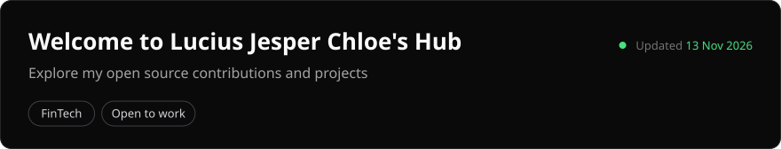
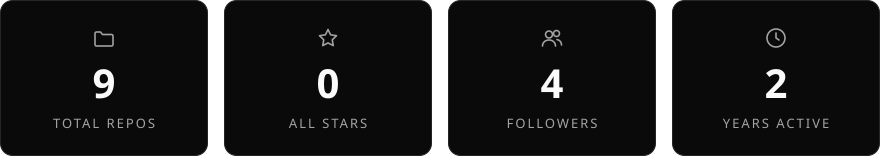
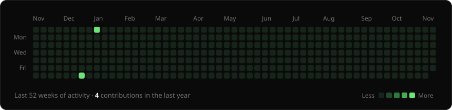
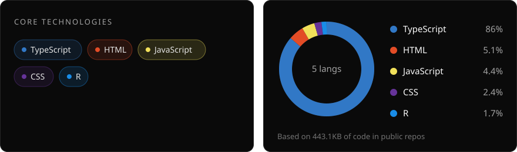
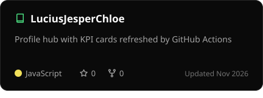
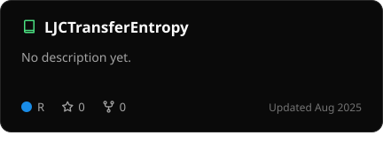
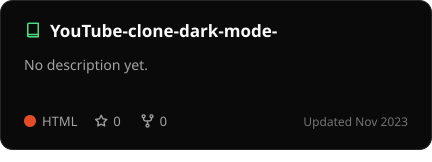

  

  

### 📊 Contributions

  

### 🧩 Tech Stack & Languages

  

### 🔖 Notable Projects · most stars

<!-- projects:start -->

<!-- projects:end -->

Cards refresh automatically every 6 hours from GitHub's API.
